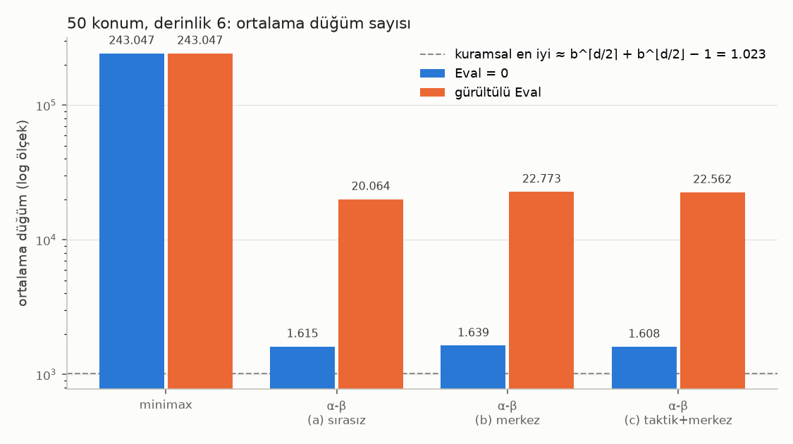

# Connect-K Arena — Rapor

**Varyant: (R, C, K, V, d) = (6, 8, 5, 2, 52)**: 6 satır, 8 sütun, K = 5, **Misère** (5'li diziyi yapan kaybeder).

Tüm sayılar `connectk/` klasöründe `python experiments.py stageN` ile bu makinede üretildi; ham veriler `results/` altında.

---

## Aşama 0 — Oyun modeli ve perft

**Tasarım.** Durum değişmez bir `State` (NamedTuple): düz `cells` tuple'ı (R·C, satır 0 en alt), `heights`
(her sütunda bir sonraki boş satır), `to_move`, `last_move`, `line_maker`, `n_moves`. `result()` yeni tuple
üretir. Dizi kontrolü yalnızca son konan taşın 4 yönüne bakar. `utility` MAX gözüyle: Misère'de
`line_maker` kaybeder. Silindir (`% C`) ve engelli (V = 3) varyantlar da aynı sınıfta.

**Perft tablosu** (`results/stage0_perft.csv`):

| konum | n=1 | n=2 | n=3 | n=4 | süre n=4 (s) |
|---|---|---|---|---|---|
| boş | 8 | 64 | 512 | 4096 | 0.010 |
| P1 `3 3 4 4 5 5` | 8 | 64 | 512 | 3802 | 0.009 |
| P2 `0 0 1 1 2 2 3 3` | 8 | 57 | 449 | 3242 | 0.008 |
| P3 (20 hamle) | 8 | 57 | 406 | 2878 | 0.007 |
| P4 (11 hamle) | 8 | 64 | 512 | 4094 | 0.011 |
| P5 (16 hamle) | 8 | 64 | 512 | 4096 | 0.011 |

Boş tahtada n = 5: 32768 (0.078 s), n = 6: 262144 (0.622 s).

**Yorum.** K = 5 iken ilk 5'li en erken 9. hamlede oluşabilir. Bu yüzden boş tahtada n ≤ 8 için perft = 8ⁿ
olur ve modeli sınamaz. Asıl sınama yarı dolu konumlardadır. P2'de MAX'in 4. sütuna oynaması 5'li yapıp
oyunu bitirir; bu yüzden perft(2) = 7·8 + 1 = 57 (elle doğrulandı, birim testinde de var).
<!-- TODO: öğretmenin 3 kontrol konumu geldiğinde tabloya eklenecek -->

---

## Aşama 1 — Minimax

**Tasarım.** `max_value` / `min_value` (MAX gözüyle). İlk satır terminal kontrolü, ikinci satır `depth == 0`
(şimdilik Eval = 0). Düğüm sayacı her çağrıda (kök dahil) 1 artar. Beraberlik kuralı: eşit değerli hamlelerden
merkeze en yakın olanı, o da eşitse küçük sütunu seç (C = 8 için sıra 3, 4, 2, 5, 1, 6, 0, 7). Böylece aynı
konumda her koşu aynı hamleyi verir.

**Ölçüm** (`results/stage1_minimax.csv`, b_etkin = düğüm^(1/derinlik)):

| konum | d=2 hamle / düğüm | d=4 hamle / düğüm | d=6 hamle / düğüm | b_etkin (d=6) | süre d=6 (s) |
|---|---|---|---|---|---|
| P1 | 3 / 73 | 3 / 4345 | 3 / 250405 | 7.94 | 0.66 |
| P2 | 3 / 65 | 3 / 3705 | 3 / 210629 | 7.71 | 0.55 |
| P3 | 4 / 65 | 4 / 3292 | 4 / 167782 | 7.43 | 0.45 |
| P4 | 3 / 73 | 3 / 4679 | 3 / 297916 | 8.17 | 0.83 |
| P5 | 3 / 73 | 3 / 4681 | 3 / 299241 | 8.18 | 0.94 |

**Yorum.**
- Budamasız minimax'ta b_etkin ≈ C = 8 olur, çünkü her düğümün bütün çocuklarına bakılır. Derinlik 2'de değer
  8'in biraz üstünde çıkar (8.54 = √73): sayaca iç düğümler de girdiği için düğüm sayısı 1 + C + C² olur, C²
  değil. Derinlik arttıkça bu etki azalır.
- b_etkin'in 8'in altına düştüğü konumlar (P2, P3) arama içinde **oyunun bittiği** dallar içerir. Misère'de
  5'li yapan hamle terminal olduğundan altı açılmaz (P2'de MAX'in 4. sütunu: derinlik 2'de 1 + 1 + 7·9 = 65).
- Eval = 0 olduğundan değerlerin hepsi 0 çıktı. Seçilen hamle yalnızca beraberlik kuralıyla (merkez) belirlendi;
  istisna P3: orada MAX'in 3. sütunda dikey 4 taşı var, 3'e oynamak doğrudan 5'li (Misère'de kayıp, değer −1),
  bu yüzden bir sonraki merkez sütun 4 seçildi. Aşama 3'teki Eval bu körlüğü giderecek.
- Derinlik 6 yaklaşık 0.5–0.9 s sürüyor. 1 saniyelik limitte düz minimax ile en fazla 6'ya inilebilir.
  Aşama 2'deki α-β bunun için gerekli.
<!-- TODO: öğretmenin 5 konumu geldiğinde positions.txt güncellenip tablo yeniden üretilecek -->

## Aşama 2 — α-β budaması ve hamle sıralaması

**Tasarım.** `ab_max_value` / `ab_min_value`: MAX'te `v >= beta` ise kes, MIN'de `v <= alpha` ise kes
(eşitlikte de kesmeyi seçtim: değer aynı, düğüm daha az). Kökte her çocuk aynı fonksiyonla çağrılır ve
alpha (MAX sırasıysa) güncellenir; hamle yalnızca kesin iyileşmede değişir. Üç sıralama:
(a) `none` soldan sağa, (b) `center_out` merkezden dışarı,
(c) `tactical_center_out`: standartta önce kazanan, sonra engelleyen hamle; **Misère'de kendi 5'lisini
tamamlayan intihar hamlesi en sona**; geri kalanı merkezden dışarı.

**Doğruluk testi.** `random_positions(seed=52)` ile 50 terminal olmayan konum (6–24 rastgele hamle), derinlik 6.
İki yaprak değerlendirmesiyle denedim: Föydeki gibi **Eval = 0** ve her yaprağa konuma bağlı sabit, sözde rastgele
değer veren **gürültülü Eval**. Eval = 0'da neredeyse bütün değerler 0 olduğundan "α-β = minimax" testi zayıf
kalır; gürültülü Eval gerçek bir sınamadır. **50 × 3 × 2 = 300 aramanın hepsinde kök değeri, seçilen hamlenin
değeri minimax ile aynı; α-β hiçbir konumda minimax'tan fazla düğüme bakmadı** (`uyumsuz = 0`).

**Ortalama düğüm** (`results/stage2_summary.csv`, grafik `results/stage2_nodes.png`):

| Eval | yöntem | ort. düğüm | minimax'a oran | b_etkin | ort. süre (ms) | µs/düğüm |
|---|---|---|---|---|---|---|
| 0 | minimax | 243 047 | 1.000 | 7.90 | 725 | 2.98 |
| 0 | (a) none | 1 615 | 0.007 | 3.43 | 5.1 | 3.16 |
| 0 | (b) center_out | 1 639 | 0.007 | 3.43 | 6.2 | 3.78 |
| 0 | (c) tactical | 1 608 | 0.007 | 3.42 | 14.0 | 8.69 |
| gürültü | minimax | 243 047 | 1.000 | 7.90 | 812 | 3.34 |
| gürültü | (a) none | 20 064 | 0.083 | 5.21 | 69 | 3.45 |
| gürültü | (b) center_out | 22 773 | 0.094 | 5.32 | 92 | 4.05 |
| gürültü | (c) tactical | 22 562 | 0.093 | 5.32 | 145 | 6.45 |

**Sıralama maliyeti** (tek `order()` çağrısı, `results/stage2_order_cost.csv`): none 0.50 µs, center_out 1.68 µs,
tactical 12.35 µs. Taktik sıralama her hamle için iki kez `makes_line` çağırdığından düğüm başına maliyeti
yaklaşık 2–3 katına çıkarıyor.

**Yorum.**
- **Beklenen sıra (c < b < a) bu aşamada çıkmadı; nedeni Eval.** Sıralama, "iyi hamleyi önce dene" demektir;
  bu, değerlerin hamle kalitesiyle ilişkili olmasını gerektirir. Eval = 0'da bütün terminal olmayan yapraklar
  eşittir: ilk çocuk zaten pencerenin sınırına ulaşır ve `>=` / `<=` eşitlikte kestiği için hangi sırayla
  bakılırsa bakılsın neredeyse mükemmel budama olur (b_etkin 3.4; kuramsal en iyi √8 ≈ 2.83). Gürültülü Eval'de
  ise değerler merkezle ilişkisizdir; merkez önce gelmesi bir avantaj sağlamaz, hatta biraz kötüleşir.
  Taktik sıralama Misère'de yalnızca intihar hamlelerini sona atar; bunlar zaten tek düğümlük terminal
  yapraklar olduğundan budamaya etkisi küçük. Sıralamanın gerçek etkisi Aşama 3'teki anlamlı Eval ile
  yeniden ölçülecek.
- **O(b^(m/2)) ile karşılaştırma:** mükemmel sıralamada derinlik 6, b = 8 için yaklaşık 8³ + 8³ − 1 = 1 023 yaprak
  (Knuth–Moore). Eval = 0 ile ölçülen 1 608 düğüm (iç düğümler dahil) bu sınıra çok yakın. Gürültülü Eval'de
  22 562, yani en iyi durumun ~22 katı: b_etkin 5.3, minimax'ın 7.9'u ile √8 arasında.
- **En az budanan konumlar:** gürültülü Eval'de konum 44 (13 hamle oynanmış; α-β/minimax = 0.169).
  Erken konumlarda hiçbir dal terminale ulaşmaz ve değerler birbirine yakın, rastgele dağılır; kesmeyi
  tetikleyen ±1'lik kesin değerler yoktur. Eval = 0'da en az budananlar 22–23 hamlelik konumlar (oran ≈ 0.012):
  orada intihar dalları −1/+1 vererek eşitlikleri bozar ve bazı alt ağaçların tamamen açılması gerekir.
- **Kontrol noktası 2 hazırlığı:** β kesmesi bir kopyada üç şekilde bozuldu. `>=` → `>` değeri bozmaz, yalnızca
  düğüm sayısını artırır (sabit konumda 222 → 320). Bunu `test_node_count_regression` yakalar. `<=` ve
  `>= alpha` değeri bozar; bunları `test_alphabeta_equals_minimax` yakalar.

## Aşama 3 — Değerlendirme fonksiyonu

_(doldurulacak)_

## Aşama 4 — Zaman sınırlı arama

_(doldurulacak)_

## Aşama 5 — Turnuva ve yenilgi analizi

_(doldurulacak)_
